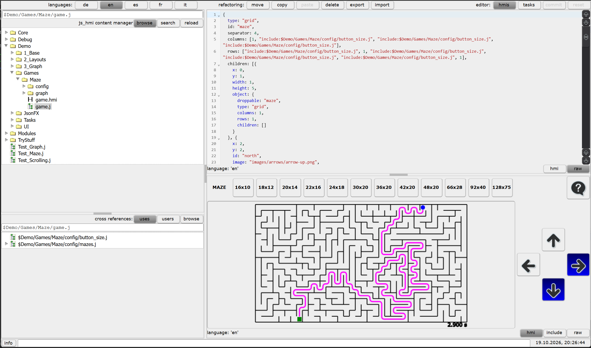
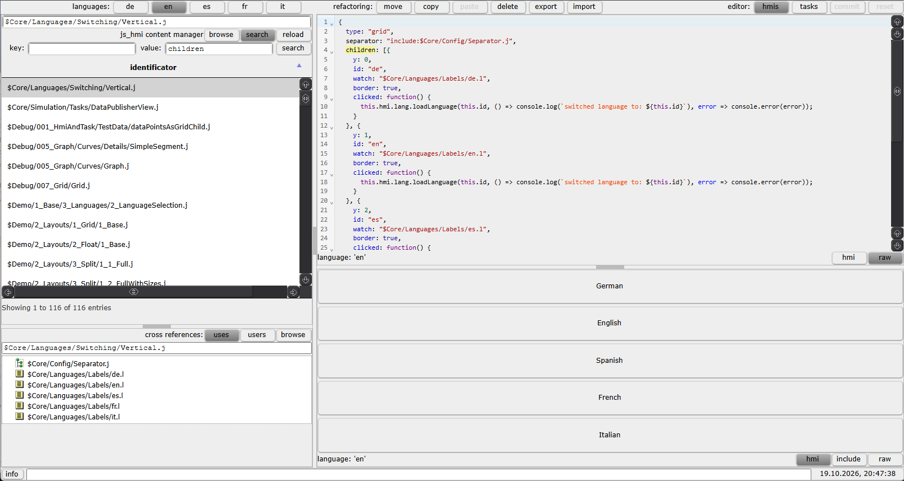

# Content Editor

The Content Editor is the browser-based tool for browsing, searching, previewing,
and editing content stored in the installation's database. It is created by
`ContentEditor.create(hmi)` as a tree of JavaScript HMI objects. The
`ObjectLifecycleManager` processes that tree's `type`, layout, and control
attributes and creates the page, including its split panes, tables, text
editors, buttons, and live HMI preview.

## Opening the editor

Open the application URL without an `hmi` query parameter, for example
`https://<host>/`. The browser displays the Content Manager administrator login
before opening the editor. Enter the administrator user name and password
configured by the consuming application in `contentManagerAdmin`. An
authenticated session is not implied by the URL: loading a URL with an `hmi`
query parameter continues to request that HMI page instead.

## Main editor view

The page is arranged as a header, a large split work area, and a footer. The
left and right sides of the work area are independently split into upper and
lower panes.

### Header

- **Languages** (top left) selects the language used to load localized content.
  Language-specific labels and HTML are shown for the selected language.
- **Refactoring** (near the middle) provides `move`, `copy`, `paste`, `delete`,
  `export`, and `import` operations. `paste` is used after selecting a move or
  copy source and then selecting its destination.
- **Editor** (top right) has `hmis` and `tasks` buttons for configuring HMI
  mappings and server-side tasks associated with JsonFX objects. `commit`
  writes pending edits; `reset` discards them. These actions are enabled only
  when applicable.

### Left side: navigation and cross references

The upper-left pane is the navigator:

- The key field at its top shows the selected content key. Enter a key and
  press Enter to select it. Keys include their content extension, for example
  `$Demo/Games/Maze/game.j`.
- `browse` displays the database tree. Expand folders and select an object to
  load it into the editor and preview.
- `search` opens the search form described below.
- `reload` refreshes the navigator and the selected object's related views.

The lower-left **cross references** pane shows relationships for the selected
key. `uses` lists content referenced by the selected object; `users` lists
content that refers to it. Select a reference to preview it, or use `browse` to
make that referenced key the current selection in the navigator.

### Right side: editor and preview

The upper-right pane is the editor. Its content depends on the selected key's
type: JsonFX and text content use a CodeMirror editor; labels are edited per
language; HMI mappings and task definitions expose their configuration fields.
Changes are tracked until committed or reset.

The lower-right pane previews the selected content. Its mode buttons vary by
content type:

- **JsonFX:** `raw` displays the stored definition, `include` displays it with
  included objects expanded, and `hmi` renders the parsed object as an HMI
  control or page.
- **Text and HTML:** `raw` displays the stored value and `include` displays
  the expanded value where includes apply. HTML is rendered in the preview.
- **Labels:** displays the value for each configured language.
- **HMI mappings and tasks:** displays their configured object, enable or
  autorun state, and task cycle interval as applicable.

The preview is useful for checking a JsonFX HMI object without leaving the
editor. In the first screenshot, the selected `$Demo/Games/Maze/game.j` is
shown in the upper-right CodeMirror pane and rendered as a playable maze in the
lower-right HMI preview. The `hmi`, `include`, and `raw` buttons at the
bottom-right switch how that preview is produced.

The footer displays editor status and informational or error messages; the
clock is at the bottom right. If an operation reports an error, read the
message there before continuing.

## Searching database content

Click `search` above the navigator to switch the upper-left pane to the search
form. Enter a substring in either or both fields:

- **key** searches content keys.
- **value** searches stored content values.
- If both fields are non-empty, a result must match both the key and the
  value. The search button runs the query; pressing Enter in either field does
  the same.

The results table lists matching identifiers and their content-type icons.
Select a row to make that object the current selection; its key, cross
references, editor, and preview update accordingly. The search term in the
value field is also highlighted in the editor or preview when supported.
Click `browse` to return to the tree, or `reload` to refresh the current data.

## Editing workflow

1. Find an object using `browse`, the key field, or `search`; select it.
2. Choose the language at the top when editing localized content.
3. Edit the value in the upper-right pane. For JsonFX, use `raw` to edit the
   stored definition in CodeMirror, or `hmi` to work with the parsed HMI
   object when supported. Check the lower-right preview, including `include`
   mode when the object uses included definitions.
4. Click `commit` to save. If you changed the key, it must still be a valid key
   for the object's content type. The editor checks for concurrent changes
   before writing; resolve any conflict message before retrying.
5. Click `reset` to discard pending edits and reload the selected content.

For content-level operations, select a key or virtual folder and use the
refactoring controls in the header. To move or copy, click `move` or `copy`,
select the destination, then click `paste`. `delete` removes the selected
content. These operations update relevant references as part of the
refactoring. `export` is activated by holding its button; `import` loads a
content exchange file.

The `hmis` and `tasks` controls in the editor header open their configuration
dialogs. HMI mappings determine which enabled HMI object is selected by an
application URL's `hmi` query parameter. Task configuration associates a
server-side task object with its cycle interval and autorun setting; tasks can
also be started or stopped from the task dialog.

For the underlying content types, key format, includes, and HMI lifecycle
behavior, see [HMI_CONFIGURATION.md](./HMI_CONFIGURATION.md).
