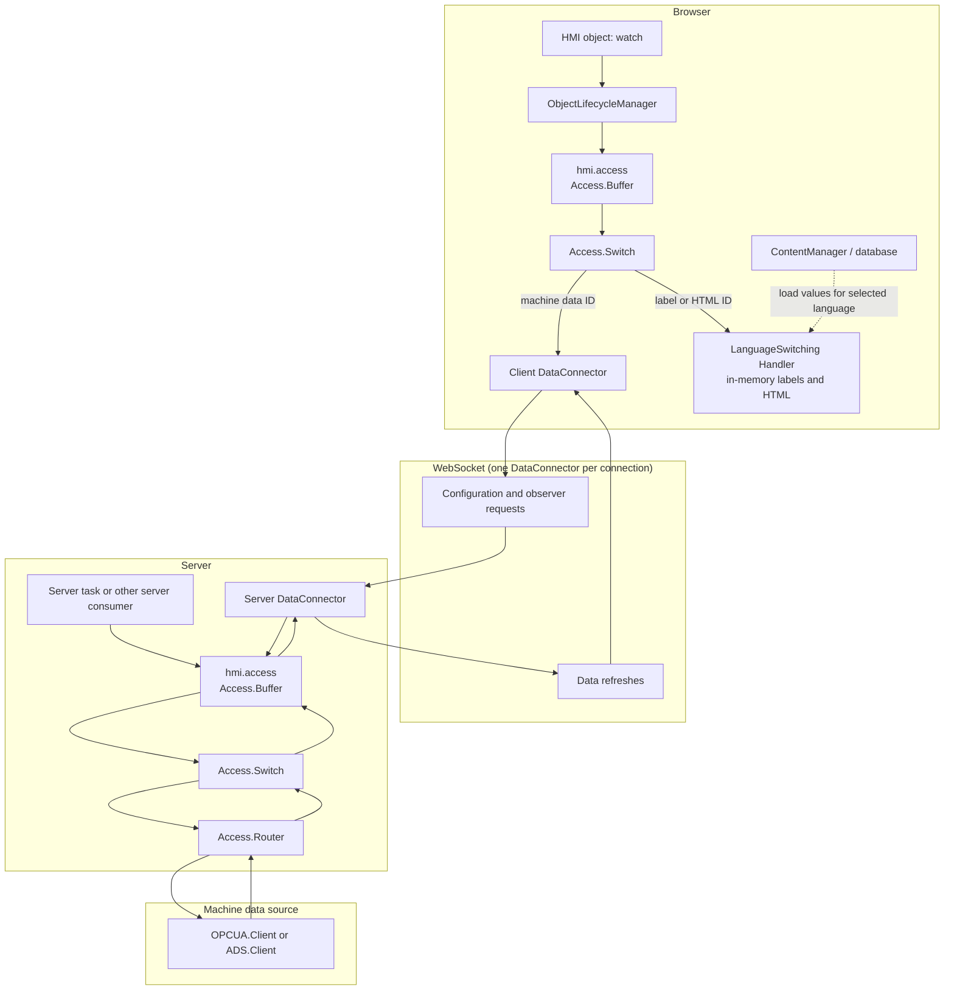

# Data access and observation flow

This document describes how data flows from an OPC UA or ADS client to HMI
objects and server-side tasks. It also explains the shared `DataAccessObject`
interface, the browser WebSocket connector, database-backed language values,
and the delays used to consolidate subscriptions.

## Overview

The same `DataAccessObject` interface is used at each layer:

- `getType(dataId)` returns the value type.
- `registerObserver(dataId, onRefresh)` subscribes to value changes.
- `unregisterObserver(dataId, onRefresh)` removes that subscription.
- `read(dataId, onResponse, onError)` reads once.
- `write(dataId, value)` writes a value.

The interface is defined in `src/Common.js`. Since each layer accepts another
`DataAccessObject` as its source, adapters can be composed without requiring
the caller to know whether an ID refers to a machine value or a language
resource.



The database branch is browser-local after language values are loaded. Machine
values use the WebSocket path between the browser and server.

## From an HMI object's `watch` to a value update

`ObjectLifecycleManager` normalizes `watch` to an array of string data IDs. A
single string is accepted as one watched ID; in an array, non-string entries
are ignored. During listener setup, it calls `hmi.access.getType(dataId)` and
registers a callback for each ID. During listener removal, it unregisters the
same callbacks in reverse order.

When an update arrives, the callback:

1. Calls the object's `handleDataUpdate(dataId, value, type)` if supplied.
   This custom handler takes precedence over default display behavior.
2. Otherwise, sends HTML-typed values to `hmi_html`.
3. Otherwise, sends values to `hmi_text`, using `formatValue(dataId, value,
   type)` when supplied. Without it, numeric values use the optional `factor`
   and `postDecimalPositions`; other values are displayed as text.

This lets database HTML, labels, and machine values use the same `watch`
subscription and callback mechanism. The selected `type` determines the
default rendering path.

Any browser-side user object and also server-side task objects processed by `ObjectLifecycleManager` can also use
`that.hmi.access`. Those subscriptions are local to the server and do not need
the browser DataConnector or WebSocket.

## Browser access and language values

The browser creates its access pipeline in `client/main.js`:

```text
hmi.access = Access.Buffer(
    logger,
    Access.Switch(id => isLanguageValueId(id) ? hmi.lang : dataConnector),
    unregisterDelay,
    reregisterDelay,
    finalDelay
)
```

The switch uses the ContentManager's language-value ID matcher to route an ID:

- A label or HTML ID is handled by the `LanguageSwitching` handler (`hmi.lang`).
- Other IDs are handled by the browser's `ClientDataConnector`.

At startup, the browser loads the selected language's labels and HTML through
the ContentManager. The ContentManager retrieves all values for that language
from the configured label and HTML content tables. `hmi.lang` keeps these
values in memory and implements the `DataAccessObject` interface. Registering
an observer for a language value therefore invokes its callback locally; a
language switch loads the new set of values and notifies existing observers.
Missing but observed IDs receive the handler's `???` fallback until the value
becomes available. Language values are not sent through the machine-data
observer protocol.

Machine IDs are passed to the ClientDataConnector. It stores callbacks and
waits for the server's short-ID configuration before it can refer to a data
point in WebSocket requests. When the set of observers changes, it sends an
`ObserverRequest` containing the short IDs of currently observed points. The
request can be coalesced by `sendObserverRequestDelay`. On receipt of a
`DataRefresh`, the client maps each short ID back to its data ID, caches the
value, and invokes the registered callback.

Reads and writes use separate `ReadRequest` and `WriteRequest` messages. They
also use the server-provided short-ID mapping. Read responses update the
client-side cached value and notify an observer, if present.

## WebSocket and server access

Each WebSocket connection has a server-side `ServerDataConnector` and a
browser-side `ClientDataConnector`. The connection carries DataConnector
messages inside the WebSocket `DataRequest`/response transport, addressed to
the `DataConnector` receiver.

On the server, `Access.Router` aggregates data point metadata from registered
targets. Each point has a fully qualified ID of the form
`<targetId>:<dataId>` and a type. The server connector maps these IDs to
connection-specific short IDs and sends the mapping to the browser as a
configuration refresh. If target data points are added or removed, the router
updates the registered connectors and their configurations.

The server's main access path is:

```text
hmi.access
  -> Access.Buffer
  -> Access.Switch
  -> Access.Router
  -> registered target DataAccessObject
```

The server DataConnector uses `hmi.access` as its source. It translates
browser short IDs back into full IDs before requesting a value or changing an
observer. The server access point is shared by server tasks and browser
connectors, so the Buffer can consolidate multiple listeners for the same ID.
When a target is registered or unregistered, the router notifies the server
Buffer to retry or stop source observers for IDs belonging to that target.

When a task starts its OPC UA or ADS client, it typically registers that
client on `hmi.router` with a `targetId`. The router validates the
`DataAccessObject` and its `getDataPoints()` method, then exposes its points
under the target-prefixed IDs. When the client stops, the task unregisters
that same object from the router. A common task pattern uses the client's
`onConnected` and `onDisconnected` callbacks to perform these registration
and unregistration steps.

## OPC UA and ADS subscriptions

The OPC UA and ADS clients implement the `DataAccessObject` interface.
Their configured `dataId`s identify entries in their respective node/symbol
configuration. The router removes the target prefix before passing an
operation to the client.

Registering an observer on either protocol client records its callback. The
client then schedules its own subscription update:

- OPC UA batches changes and reconciles monitored items after its monitoring
  update delay. It creates or terminates monitored items in its OPC UA
  subscription; the current monitored-item sampling interval is 500 ms.
- ADS batches changes and reconciles symbol subscriptions after its
  subscription update delay. Its current subscription cycle time is 500 ms.

When a protocol client receives a new value, it stores the value and invokes
its registered callback. That callback propagates the value through the router
and server Buffer to server-side listeners and the relevant server
DataConnector. The DataConnector then sends a `DataRefresh` to the browser,
where the client invokes the HMI object's watch callback.

These protocol-level update delays are separate from the access-point and
WebSocket coalescing delays described below.

## Subscription delays and lifecycle

`Access.Buffer` creates one `Access.Node` per data ID. It keeps a list of local
observers and registers only one observer on its source while that ID is in
use. `Access.Node` uses `Core.OnOffDelay` to coordinate source registration,
unregistration, and final cleanup:

- **Unregister delay** (`offDelay`): after the last local observer leaves,
  keep the source observer temporarily. If a new observer arrives in that
  interval, the pending source unregistration is cancelled.
- **Reregister delay** (`onDelay`): after the source has actually been
  unregistered, wait before registering it again. If local observers disappear
  during this wait, the source is not registered.
- **Final delay** (`finalDelay`): after source unregistration, retain the
  otherwise unused Node briefly before disposing it. This provides a further
  reuse window; it does not itself keep the source subscription active.

These are per-data-ID delays at each `Access.Buffer` layer. The client has its
own access point and the server has another, so one browser subscription may
pass through both. A server-side task subscription passes through the server
access point only.

The server reads `clientAccessPointUnregisterObserverDelay`,
`clientAccessPointReregisterObserverDelay`, and
`clientAccessPointFinalDelay` from its configuration and delivers them to the
browser as the access-point delay settings. It uses
`serverAccessPointUnregisterObserverDelay`,
`serverAccessPointReregisterObserverDelay`, and
`serverAccessPointFinalDelay` for its own access point. Missing, non-positive,
or non-numeric delays are treated as disabled by `Access.Buffer`.

Other coalescing settings operate at different points:

- `sendObserverRequestDelay` combines browser observer-set changes before the
  client sends an observer request.
- `dataConnectorSendDelay` combines refreshed values before the server sends
  a data refresh.
- OPC UA and ADS each have their own protocol subscription update scheduling.

On a WebSocket close, the browser connector clears its pending observer-send
timer. The server connector clears any pending value-send timer and resets its
remote observations. On reconnection, the server sends the data point
configuration again and the browser re-sends its current observer set.
